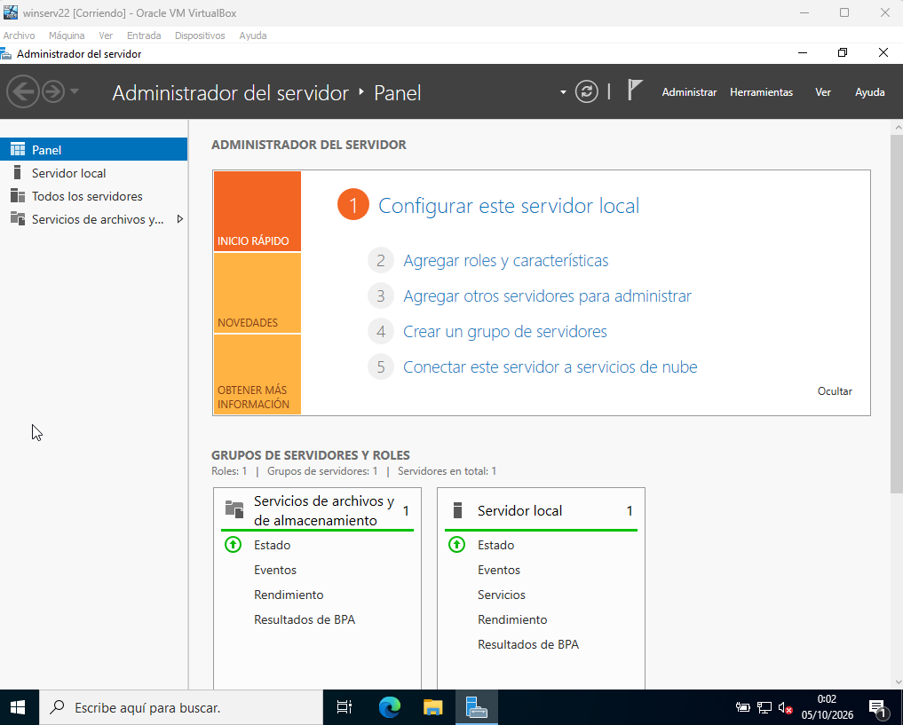

# Lab 1 — Primera máquina virtual: Windows Server 2022

**Fecha:** 4 de octubre de 2026

**Objetivo:** montar la base del laboratorio: un Windows Server 2022 virtualizado que usaré en los siguientes labs como controlador de dominio.

## Entorno

| Elemento | Configuración |
|---|---|
| Hipervisor | Oracle VirtualBox 7 |
| Sistema | Windows Server 2022 Standard Evaluation (Experiencia de escritorio) |
| RAM | 4 GB (4096 MB) |
| CPU | 2 núcleos |
| Disco | 40 GB, reserva dinámica |
| Red | NAT, perfil de red privado |

## Qué hice

1. Descargué la ISO de evaluación (180 días) del Microsoft Evaluation Center.
2. Cambié la carpeta predeterminada de máquinas de VirtualBox a un disco secundario con más espacio libre.
3. Creé la VM con instalación manual: tipo "Personalizada", edición con Experiencia de escritorio y disco sin particionar.
4. Configuré el perfil de red como Privado para que el servidor sea detectable en los siguientes labs.

## Problema / Causa / Solución

**Problema:** al crear la VM, el asistente mostró una pantalla con usuario "vboxuser", clave de producto y nombre de equipo ya rellenados, y el nombre de equipo daba error.

**Causa:** VirtualBox 7 activa por defecto la instalación desatendida, que instala Windows solo con valores genéricos. El nombre de equipo propuesto, tomado del nombre de la VM, tenía espacios, y los nombres de equipo de Windows no los admiten (máximo 15 caracteres: letras, números y guiones).

**Solución:** volví atrás y marqué "Omitir instalación desatendida" para hacer la instalación manual y controlar edición, disco y contraseña.

## Resultado

## Qué he aprendido

- Diferencia entre Server Core (solo consola) y Experiencia de escritorio.
- Disco dinámico frente a disco de tamaño fijo.
- Perfiles de red de Windows (Público, Privado, Dominio) y cómo cambian las reglas del firewall.
- VirtualBox asigna la RAM en MB binarios: 4 GB = 4096 MB.
- Guest Additions: drivers del hardware virtual de VirtualBox (vídeo, ratón, portapapeles), equivalentes a VMware Tools.
- Instantáneas (snapshots) como punto de restauración antes de cambios; no sustituyen a una copia de seguridad.
